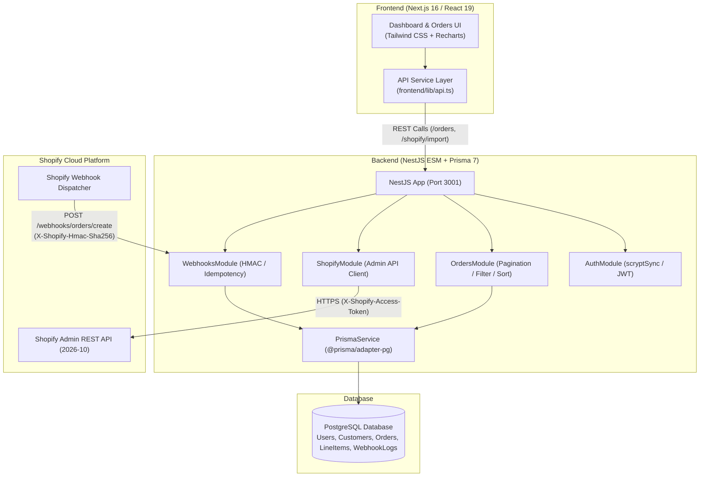

# Shopify Order CRM

A full-stack, enterprise-grade Shopify Order Management and CRM system built with **NestJS**, **Prisma 7**, **PostgreSQL**, and **Next.js 16 (React 19, Tailwind CSS)**.

Designed with a warm custom palette:
- `#eb5e28` (Primary Flame / Accent)
- `#252422` (Dark Charcoal / Primary Text)
- `#403d39` (Slate Olive / Secondary Text)
- `#ccc5b9` (Sand / Borders & Dividers)
- `#fffcf2` (Warm Ivory / Background Canvas)

---

## Architecture Overview



---

## 1. Shopify Integration

### Authentication Flow
The CRM integrates with the **Shopify Admin REST API** using a Custom App / Private App authentication flow:
- All outbound requests to Shopify carry the private app secret header:
  ```http
  X-Shopify-Access-Token: shpat_xxxxxxxxxxxxxxxxxxxxxxxx
  Content-Type: application/json
  ```
- Store host domain format: `https://{SHOPIFY_SHOP_DOMAIN}/admin/api/{SHOPIFY_API_VERSION}/...` (e.g. `https://my-store.myshopify.com/admin/api/2026-10/orders.json`).

### Required Shopify API Scopes
To enable full CRM synchronization, the Custom App must be granted the following **Admin API access scopes**:
| Scope | Type | Purpose |
| :--- | :--- | :--- |
| `read_orders` | Read | Fetch historical and real-time orders, line items, and fulfillment statuses |
| `write_orders` | Read/Write | Create new orders directly in Shopify from the CRM interface |
| `read_customers` | Read | Fetch customer contact information, addresses, and order histories |
| `write_customers` | Read/Write | Automatically create or link customer profiles when creating new orders |
| `read_products` | Read | Validate catalog items, variant identifiers, and inventory status |

### Setup Guide in Shopify Store Admin
1. Navigate to **Shopify Admin** &rarr; **Settings** &rarr; **Apps and sales channels**.
2. Click **Develop apps**, then **Create an app**.
3. Name the app `CRM Order Sync` and assign your App Developer account.
4. Under **Configuration** &rarr; **Admin API integration**, select the 5 required scopes listed above.
5. Click **Save** and **Install app**.
6. Reveal and copy the **Admin API access token** (starts with `shpat_`).
7. Paste it into `backend/.env` under `SHOPIFY_ADMIN_ACCESS_TOKEN`.
8. Under **API credentials**, copy the **Webhook signing secret** into `backend/.env` as `SHOPIFY_WEBHOOK_SECRET`.

---

## 2. Orders Section & Performance

The Orders module is built for large-scale datasets and enforces server-side processing:
- **Server-Side Pagination**: Implemented via Prisma `skip: (page - 1) * limit` and `take: limit`. Default page size is 10 items.
- **Search Capabilities**: Query parameter `search` matches against:
  - Order numbers (`orderNumber` contains search term, case-insensitive).
  - Customer first name or last name (`customer.firstName` / `customer.lastName` contains search term).
- **Filtering**:
  - `financialStatus`: Filter by `paid`, `pending`, `refunded`, `partially_paid`, etc.
  - `fulfillmentStatus`: Filter by `fulfilled`, `unfulfilled`, `partial`, `restocked`.
  - Date range: `startDate` and `endDate` ISO strings query `orderDate >= startDate` and `orderDate <= endDate`.
- **Sorting**:
  - Sort by `orderDate` or `totalAmount` in either `asc` (ascending) or `desc` (descending) order.
- **Zero Full-Dataset Dumping**: The browser only receives the requested slice along with metadata:
  ```json
  {
    "data": [ ... ],
    "pagination": {
      "total": 1280,
      "page": 1,
      "limit": 10,
      "totalPages": 128
    }
  }
  ```

---

## 3. Order Details

Selecting an order opens an in-depth modal or details view presenting:
- **Header Details**: Order number (`#1001`), creation date & time, sync timestamp, and internal ID.
- **Customer Information**: Full name, email address, phone number, and linked customer record.
- **Statuses**: Visual badges for Payment/Financial status (`Paid`, `Pending`, `Refunded`) and Fulfillment status (`Fulfilled`, `Unfulfilled`).
- **Financial Breakdown**: Currency (`INR`, `USD`, `EUR`, etc.), subtotal, tax/shipping adjustments, and total amount.
- **Line Items Table**: Product title, SKU, unit price, quantity, and total line price.
- **Shopify Identifiers**: External `shopifyId` and `shopifyOrderNumber` ensuring zero ambiguity when referencing records in Shopify Admin.

---

## 4. Webhook Integration

### Webhook Endpoints
- `POST /webhooks/orders/create` - Triggered when a new order is placed in Shopify.
- `POST /webhooks/orders/updated` - Triggered when an order's status, line items, or fulfillment changes.
- `GET /webhooks/logs` - Diagnostic endpoint reporting recent webhook events and processing outcomes.

### HMAC Signature Verification
All incoming webhooks are validated before processing to ensure authenticity:
1. The raw request body is captured prior to JSON parsing.
2. An HMAC-SHA256 signature is generated using `crypto.createHmac('sha256', process.env.SHOPIFY_WEBHOOK_SECRET)`.
3. The computed signature (base64-encoded) is compared against the incoming `X-Shopify-Hmac-Sha256` header using `crypto.timingSafeEqual` to prevent timing attacks.
4. If invalid, the request is immediately rejected with HTTP `401 Unauthorized` and logged with status `INVALID_SIGNATURE`.

### Idempotency & Deduplication
Shopify guarantees *at-least-once* webhook delivery, which can result in duplicate deliveries. To guarantee safety:
1. Each incoming request extracts the unique `X-Shopify-Webhook-Id` header (or computes a SHA-256 fingerprint of the payload).
2. The service checks the `WebhookLog` database table for this ID.
3. If the event was already successfully processed (`PROCESSED`), the backend logs `DUPLICATE_IGNORED` and immediately returns HTTP `200 OK` without re-executing writes or mutations.
4. If new, the record is logged as `PENDING` and transitioned to `PROCESSED` upon transaction commit.

### Safe Failure Acknowledgement & Recovery
- When an unexpected error occurs during order upsert, the transaction rolls back, the error message is recorded in `WebhookLog` with status `FAILED`, and an HTTP `500` is returned so Shopify's exponential backoff retry policy can re-attempt delivery.
- Administrators can inspect `GET /webhooks/logs` to identify failed payloads, fix schema or constraint issues, and trigger manual re-syncs.

---

## 5. Order Creation

Users can create new orders directly from the CRM interface:
- **Modal Form**: Captures customer details (name, email, phone), currency, financial status, and a dynamic list of line items (product name, quantity, unit price).
- **Shopify API Flow**:
  1. The CRM backend issues a `POST` request to `https://{SHOPIFY_SHOP_DOMAIN}/admin/api/2026-10/orders.json`:
     ```json
     {
       "order": {
         "email": "customer@example.com",
         "financial_status": "paid",
         "currency": "INR",
         "line_items": [
           {
             "title": "Ergonomic Office Chair",
             "price": "12999.00",
             "quantity": 1
           }
         ],
         "customer": {
           "first_name": "Aarav",
           "last_name": "Sharma",
           "email": "customer@example.com"
         },
         "send_receipt": false
       }
     }
     ```
  2. **Persistence**: Only once Shopify responds with `201 Created` is the order persisted to the local PostgreSQL database, storing Shopify's generated `id` and `order_number`.
  3. **Error Isolation**: If Shopify rejects the payload (e.g. invalid currency, unconfigured shipping zone, invalid line item), the backend throws a `BadRequestException` with Shopify's exact validation error. No orphan or misleading local records are ever created.

### Chosen Flow & Limitations
- **Custom Line Items vs. Inventory**: The CRM creates custom line items by default (`title`, `price`, `quantity`). To deduct tracked inventory from specific Shopify inventory locations, product variant IDs (`variant_id`) and location IDs (`location_id`) must be passed.
- **Payment Processing**: Orders created via the Admin API bypass customer checkout payment gateways (e.g., Stripe, Shopify Payments). Marking `financial_status: "paid"` records an administrative payment; it does not charge a credit card.
- **Taxes & Shipping**: Shopify allows specifying custom tax lines or letting Shopify calculate taxes based on the store's tax settings. For administrative simplicity, total amounts can include taxes directly.

---

## 6. Authentication & Security

- **Server-Side Credential Isolation**: Shopify API tokens (`SHOPIFY_ADMIN_ACCESS_TOKEN`) and webhook secrets (`SHOPIFY_WEBHOOK_SECRET`) reside exclusively on the NestJS backend inside `.env`. The Next.js frontend only ever communicates with the backend API (`http://localhost:3001`).
- **Password Security**: Passwords in `User` table are hashed using Node.js `crypto.scryptSync` with cryptographic salts and verified using constant-time buffers.
- **Authentication Guard**: Protected endpoints require an `Authorization: Bearer <token>` header verified via `AuthGuard`.
- **Input Validation**: All incoming requests are validated against strict class-validator DTOs (`QueryOrdersDto`, `CreateOrderDto`, `LoginDto`).

---

## 7. Getting Started

### Prerequisites
- Node.js **v20+** or **v24+**
- PostgreSQL database instance
- (Optional) Shopify Partner or Development store

### Backend Setup
```bash
cd backend

# 1. Install dependencies
npm install --legacy-peer-deps

# 2. Configure environment
cp .env.example .env
# Edit .env with your PostgreSQL credentials and Shopify keys

# 3. Generate Prisma client
npx prisma generate

# 4. Push schema to database
npx prisma db push

# 5. Run tests
npm run test

# 6. Start NestJS server (runs on port 3001)
npm run start:dev
```

### Frontend Setup
```bash
cd frontend

# 1. Install dependencies
npm install

# 2. Configure environment
cp .env.example .env.local
# Set NEXT_PUBLIC_API_URL=http://localhost:3001

# 3. Run production build check
npm run build

# 4. Start Next.js development server (runs on port 3000)
npm run dev
```

Visit [http://localhost:3000](http://localhost:3000) to open the CRM dashboard.

